# Gestaltung

Festlegungen zur Gestaltung der Oberfläche. **Lukas entscheidet über die Gestaltung**; was hier
steht, hat er freigegeben. Die Entwürfe liegen als klickbares HTML unter `docs/entwuerfe/`
(Übersicht: `docs/entwuerfe/index.html`; zum Ansehen `python3 -m http.server 5190` im Projektordner
und dann `http://localhost:5190/docs/entwuerfe/` öffnen, oder in Claude Code die Vorschau
„entwuerfe“; die Entwürfe laden die Karten aus `apps/web/src/assets/karten/`).

## Richtung: „Kartentisch“ (D1, freigegeben am 11.11.2026)

Grüner Filz als Einlage in einem dunklen Holzrahmen – ein Kartentisch im Wirtshaus, aber ohne
Deko. Die Spieler sitzen um den ovalen Tisch, der Stich liegt in der Mitte, die eigene Hand als
Fächer unten. Ansage- und Ergebnis-Dialoge stehen auf hellem Papier mitten auf dem Tisch; die Hand
bleibt beim Ansagen sichtbar.

Entwurf: `docs/entwuerfe/filz.html`

| Ansage                                                        | Laufender Stich                                             | Ergebnis                                                          |
| ------------------------------------------------------------- | ----------------------------------------------------------- | ----------------------------------------------------------------- |
| 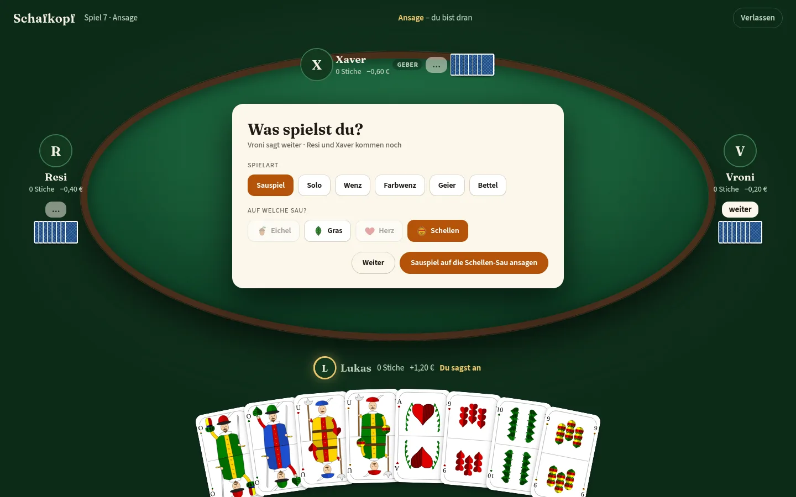 | 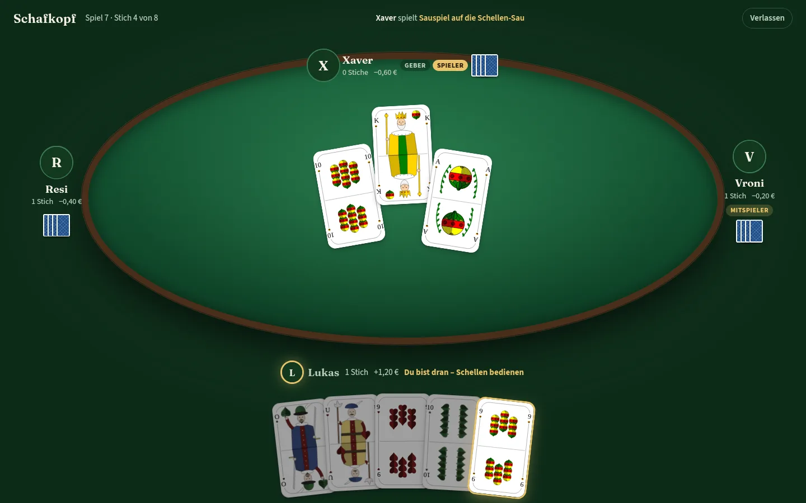 | 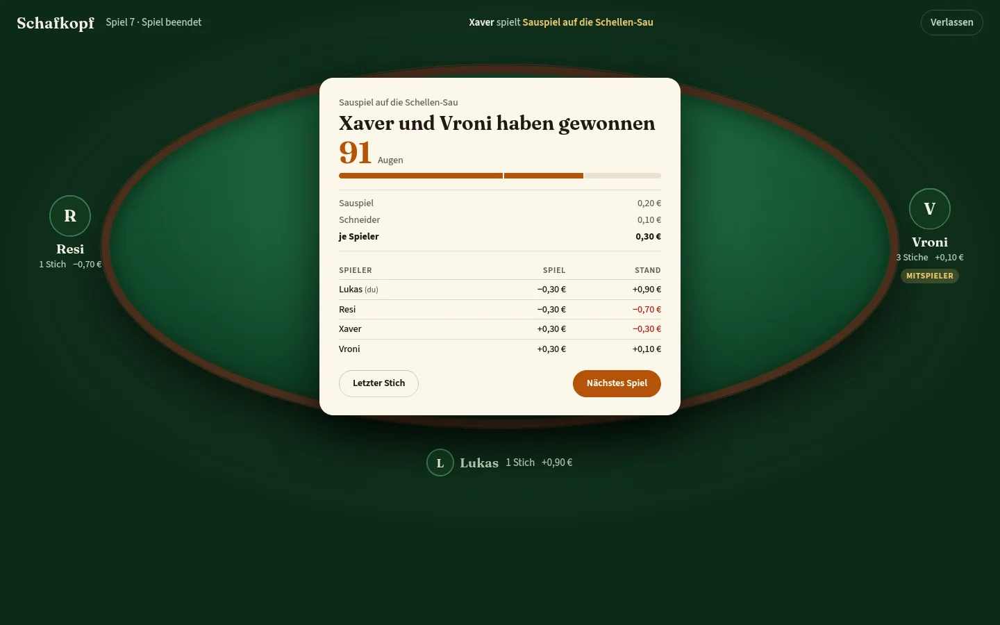 |
| 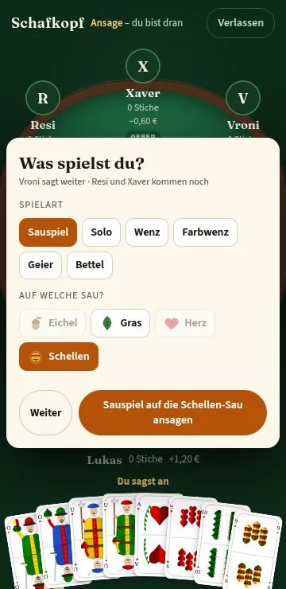     | 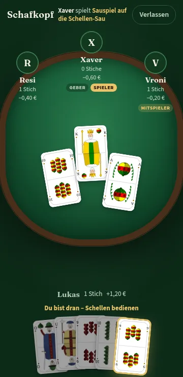     | 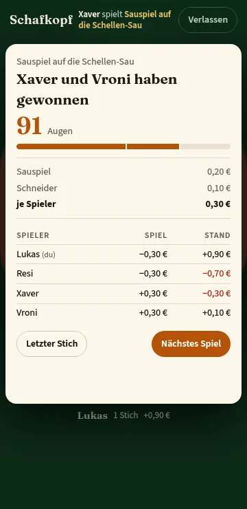     |

### Begründung

- **Grün wie bisher:** Lukas gefällt das Grün aus dem jetzigen Stand am besten. Es bleibt der
  Grundton und wird nur verfeinert (Filz, Lampenlicht, Holzrand).
- **Warm statt steril:** Der Holzrahmen und die Serifenschrift für Namen geben Gemütlichkeit; der
  Rest bleibt schlicht – keine Brezn, kein Hirschgeweih, keine Effekte.
- **Dunkel:** Lukas will einen dunklen Grundton; die hellen Karten und Papier-Dialoge stechen
  heraus.
- **Desktop zuerst:** Hauptgerät ist Desktop/Laptop; das Handy hochkant muss gut bedienbar sein.
- **Das Blatt steht im Mittelpunkt:** Der Tisch ist ruhig, damit die bunten Karten im bayerischen
  Bild wirken.

### Farben (erste Festlegung; gültige Werte unter „Gestaltungssystem (D2)“)

| Rolle                       | Wert                                     | Verwendung                                            |
| --------------------------- | ---------------------------------------- | ----------------------------------------------------- |
| Grund                       | `#0d2a18`                                | Hintergrund um den Tisch                              |
| Filz                        | `#17603a`                                | Tischplatte (Verlauf nach `#0f4428`, Licht `#2a7d4e`) |
| Holzrand                    | `#4a2f1c`                                | Rahmen um den Filz                                    |
| Schrift auf Grün            | `#f5f0e4`                                | Namen, Leiste                                         |
| Schrift auf Grün, leise     | `#b9cdb9`                                | Stiche, Stand, Nebeninfos                             |
| Messing                     | `#e9c46a`                                | Wer dran ist, spielbare Karte, „Spieler“-Marke        |
| Papier                      | `#fbf7ec`                                | Dialoge, Sprechblasen                                 |
| Schrift auf Papier          | `#1f1a14` / leise `#6b6355`              | Text in Dialogen                                      |
| Akzent (Handlung)           | `#b45309`                                | Hauptknopf, gewählte Spielart, Augenzahl              |
| Minus auf Papier / auf Grün | `#b42318` / `#ffb4a6`                    | negative Beträge                                      |
| Kartenrücken                | SVG, Nachtblau `#14305a` mit Rauten (U2) | verdeckte Karten                                      |

Die Kontrastprüfung in D2 hat einige Werte angepasst, siehe unten.

### Schrift (erste Festlegung)

- **Fraunces** (Serif, 500/650) für Namen, Überschriften und die Augenzahl.
- **Source Sans 3** (400/600/700) für alles andere; Zahlen mit `tabular-nums`.
- Beide stehen unter der SIL Open Font License. In der App werden sie **selbst ausgeliefert**,
  nicht von Google Fonts geladen (kein Fremdserver, auch offline nutzbar); umgesetzt in D2.

### Karten (U2, freigegeben am 11.11.2026)

Das Blatt ist das bayerische Bild: doppelbildig, Eckzeichen an allen vier Ecken. Übersicht aller
Karten bei normaler Größe und 44 px: `docs/entwuerfe/karten.html`; die Auswahl aus Haltepunkt (a):
`docs/entwuerfe/u2-auswahl.html`.

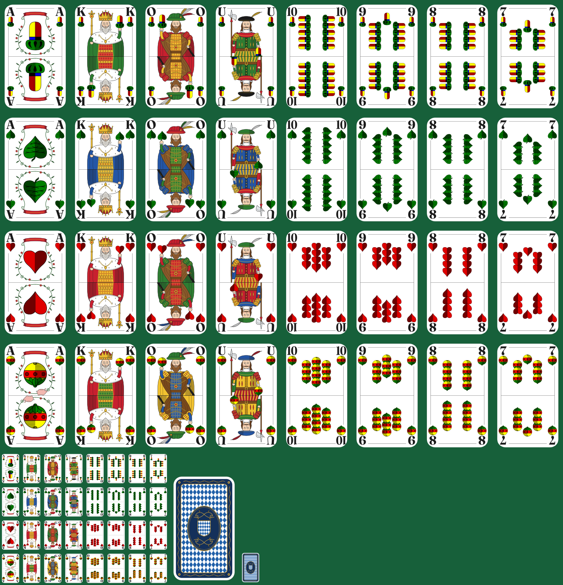

- **Zahlenkarten:** Die Bildchen stammen von Fabian Bally, einem Freund von Lukas (CC0 seit
  11.11.2026, Herkunft in `apps/web/scripts/karten/vorlagen/LIZENZ.md`). Rahmen und Eckzeichen sind
  neu.
- **Bildkarten** im Geist des Schmid-Blatts, selbst gezeichnet. Lukas wollte „mehr Ornamente und wie
  Schmid“ und meinte damit Kleidung und Falten, Figur und Gesicht sowie Zierrat und Muster (nicht
  die Farben). Aus drei Varianten am Herz-Ober hat er gewählt: „B (Edelmann), aber mit Hut und
  Schwert von A (Landsknecht)“.
  - **Ober:** Edelmann in der Schaube mit Pelzkragen, Brokatwams und Goldkette, Barett mit drei
    Federn, Katzbalger an der Hüfte; hält das Farbzeichen hoch.
  - **Unter:** Landsknecht mit Schlitzwams, Puffärmeln, Halskrause und Hellebarde, flaches Barett mit
    einer Feder; hält das Farbzeichen unten an der Mittellinie – so unterscheidet man ihn vom Ober.
  - **König:** Hermelin-Pelerine, Mantel, Brokat-Tunika, Krone und Zepter, weißer Vollbart;
    Farbzeichen oben rechts.
  - **Sau:** großes Farbzeichen im Kranz aus Ranken mit Blüten, darüber ein Schriftband; auf der
    Schellen-Sau eine kleine Sau.
  - Kleidungsfarben wechseln je Farbe (`KLEID_*` in `figuren.mjs`); rechts liegt wie bei den
    Bildchen eine Schraffur als Schatten.
- **Eckzeichen:** Buchstabe bzw. Zahl in Fraunces (als Pfade, damit sie nicht von der Systemschrift
  abhängen), Versalhöhe 14 % der Kartenbreite statt bisher etwa 8 %; darunter dasselbe Farbzeichen
  wie auf den Zahlenkarten (Lukas: die Zeichen sollen überall dieselben sein). Auch im Ansage-Dialog
  stehen seit U2 diese Zeichen.
- **Rücken:** Rautenfeld in einer goldenen Rankenbordüre auf Nachtblau, in der Mitte ein
  Rautenschild im Ranken-Oval (Lukas: Vorschlag 3 mit dem Emblem aus Vorschlag 2).

**Erzeugen:** `node apps/web/scripts/karten/erzeuge-karten.mjs` schreibt die 32 Karten, den Rücken
und die vier Farbzeichen nach `apps/web/src/assets/karten/` und verkleinert sie mit SVGO.
Gleiche Bildchen stehen in jeder Datei nur einmal (`<use>`). Größe der Karten-SVGs im Build: vorher
1,73 MB (gzip 140 KB, 32 Dateien), nachher 355 KB (gzip 86 KB, 37 Dateien); `dist/` schrumpft von
2,74 MB auf 1,37 MB.

**Urheberrecht (Stand der Recherche, keine Rechtsberatung):** Das bayerische Bild als Muster ist
alt und frei. Die konkreten Zeichnungen der heutigen F.X.-Schmid-Karten (Marke heute bei
Ravensburger, Herstellung über Altenburger) sind dagegen vermutlich geschützt – in Deutschland bis
70 Jahre nach dem Tod des Zeichners, und das Blatt wurde zuletzt neu gezeichnet. Deshalb: Karten
selbst zeichnen und sich an den traditionellen Motiven orientieren (Haltung, Kleidung, Ornamente),
aber keine Schmid-Scans abpausen. Als Vorlage taugen gemeinfreie Drucke des Münchner Bilds aus dem 19. Jahrhundert. Quellen: [F.X. Schmid (Wikipedia)](https://en.wikipedia.org/wiki/F.X._Schmid),
[Bavarian pattern (IPCS)](https://i-p-c-s.org/pattern/ps-54.html),
[Bayerisches Einfachbild (WOPC)](https://www.wopc.co.uk/germany/ass/bayerisches-einfachbild).

### Offene Punkte für die nächsten Pakete

- ~~**Eckzeichen zu klein**~~ – in U2 vergrößert.
- ~~**Handy, Ansage:** Der Dialog überdeckt die seitlichen Plätze~~ – in D3 gelöst (Dialog unten,
  Plätze oben).
- ~~**Kartenrücken:** Platzhalter~~ – in U2 endgültig gestaltet.
- **Animationen** (Lukas, D2): Karte legen, Stich zum Gewinner wegräumen und Austeilen sind seit
  D3 umgesetzt (siehe „Spieltisch“).

## Gestaltungssystem (D2, freigegeben am 11.11.2026)

Aus der Richtung „Kartentisch“ abgeleitet. **Freigegeben von Lukas am 11.11.2026.**

### Dateien

| Datei                                | Inhalt                                                                       |
| ------------------------------------ | ---------------------------------------------------------------------------- |
| `apps/web/src/styles/tokens.css`     | Alle Variablen – die einzige Stelle mit festen Farb-, Größen- und Zeitwerten |
| `apps/web/src/styles/base.css`       | Schriften, Zurücksetzen, Grundtypografie, Flächen `.surface-felt/-paper`     |
| `apps/web/src/styles/components.css` | Klassen der Bausteine (`.btn`, `.field`, `.tafel`, `.dialog`, …)             |
| `apps/web/src/styles/contrast.ts`    | Kontrastformel und die Farbpaare, die WCAG AA erreichen müssen               |
| `apps/web/src/ui/kit/`               | Bausteine als React-Komponenten                                              |
| `apps/web/src/styles/screens.css`    | Start, Lobby, Verbinden, Hinweise (seit D4, siehe „Start und Lobby“)         |
| `apps/web/src/muster/`               | Musterseite, nur im Entwicklungsserver: `http://localhost:5180/#muster`      |

Regel: **Außerhalb von `tokens.css` keine festen Farben, Längen oder Zeiten.** Erlaubt sind
Prozente, Verhältnisse und Vielfache einer Variable (z. B. `calc(var(--card-w) * 0.26)`).

### Entscheidungen

- **Nur die dunkle Filz-Variante**, kein Hell-Modus (Lukas, D2). Eine helle Variante wäre ein
  zweiter Satz derselben Variablennamen.
- **Schriften selbst ausgeliefert** über die npm-Pakete `@fontsource-variable/fraunces` und
  `@fontsource-variable/source-sans-3` (OFL 1.1). Vite bündelt die woff2-Dateien; kein Fremdserver,
  offline nutzbar. Der Browser lädt nur die Teilmengen, die er braucht (`unicode-range`).
- **Zwei Flächen:** Alles steht entweder auf Grün (`.surface-felt`) oder auf Papier
  (`.surface-paper`). Die Fläche setzt Schrift-, Leise-, Minus- und Fokusfarbe für ihren Inhalt.

### Farben

Gegenüber D1 geändert, damit alle Schriften WCAG AA erreichen: Lampenlicht `#2a7d4e` → `#1b663f`
(dezenter), leise Schrift auf Grün `#b9cdb9` → `#d0dfd0`, Minus auf Grün `#ffb4a6` → `#ffc8bd`,
Hover des Hauptknopfs dunkler statt heller (`#9a4708`), neu ein Rand für Eingabefelder.

| Variable                                          | Wert                              | Verwendung                                       |
| ------------------------------------------------- | --------------------------------- | ------------------------------------------------ |
| `--color-ground`                                  | `#0d2a18`                         | Hintergrund um den Tisch, Leisten                |
| `--color-felt` / `-deep` / `-light`               | `#17603a` / `#0f4428` / `#1b663f` | Filz, Verlauf zum Rand, Lampenlicht in der Mitte |
| `--color-felt-raised`                             | `#12391f`                         | Flächen auf dem Filz (Platz, dunkle Tafel)       |
| `--color-felt-line`                               | `#3d7a52`                         | Linien und Ränder auf Grün                       |
| `--color-wood` / `-dark`                          | `#4a2f1c` / `#2a1a0e`             | Holzrand                                         |
| `--color-on-felt`                                 | `#f5f0e4`                         | Schrift auf Grün                                 |
| `--color-on-felt-muted`                           | `#d0dfd0`                         | leise Schrift auf Grün                           |
| `--color-negative-on-felt`                        | `#ffc8bd`                         | Minus auf Grün                                   |
| `--color-brass` / `--color-on-brass`              | `#e9c46a` / `#2a1a08`             | am Zug, spielbar, Marken; Schrift darauf         |
| `--color-paper` / `-raised`                       | `#fbf7ec` / `#ffffff`             | Dialoge, Tafeln; Eingabefelder                   |
| `--color-paper-line` / `-line-soft`               | `#d9d0bd` / `#e9e1cf`             | Trennlinien auf Papier; gesperrte Felder         |
| `--color-paper-control`                           | `#8a7d66`                         | Rand von Eingabefeldern und sekundären Knöpfen   |
| `--color-on-paper` / `-muted`                     | `#1f1a14` / `#6b6355`             | Schrift auf Papier                               |
| `--color-negative-on-paper`                       | `#b42318`                         | Minus auf Papier, Fehler                         |
| `--color-accent` / `-hover` / `--color-on-accent` | `#b45309` / `#9a4708` / `#fff`    | Hauptknopf, Auswahl                              |
| `--color-card-face` / `-edge` / `-back`           | `#fff` / `#a8a29e` / `#14305a`    | Karte (Rücken-Farbe nur bis das SVG geladen ist) |

**Messing als Schrift** nur groß/fett auf Filz (≥ 3 : 1) oder auf dem dunklen Grund; kleine
Beschriftungen in Messing immer als Marke (Messing-Fläche, dunkle Schrift).

### Schrift, Abstände, Radien, Schatten, Bewegung

| Gruppe     | Variablen                                                                                                                                                                                      |
| ---------- | ---------------------------------------------------------------------------------------------------------------------------------------------------------------------------------------------- |
| Schriftart | `--font-display` (Fraunces: Namen, Überschriften, Augenzahl), `--font-body` (Source Sans 3)                                                                                                    |
| Größen     | `--text-xs` 12 · `-sm` 14 · `-md` 16 · `-lg` 20 · `-xl` 24 · `-2xl` 32 px                                                                                                                      |
| Gewichte   | `--weight-regular` 400 · `-semibold` 600 · `-bold` 700 · `-display` 650 · `-display-light` 500                                                                                                 |
| Abstände   | `--space-1` … `--space-7`: 4 · 8 · 12 · 16 · 24 · 32 · 48 px                                                                                                                                   |
| Größen     | `--control-height` 44 px (Tippfläche), `-sm` 36 px, `--avatar-size`, `--card-w`, `--card-h`, `--card-ratio` 115 : 195                                                                          |
| Radien     | `--radius-sm` 6 · `-md` 10 · `-lg` 16 px · `-pill`; Karte `--card-radius`                                                                                                                      |
| Schatten   | `--shadow-card`, `-raised` (Tafel), `-dialog`, `-turn` (Messing-Schein), `-playable`, `-rim` (Holzrand)                                                                                        |
| Bewegung   | `--duration-fast` 120 · `-base` 200 · `-slow` 360 ms, `--ease-out`, `--ease-in-out`; bei „Bewegung reduzieren“ alle 0 ms; seit D3 dazu `--duration-sweep`, `--duration-deal-step`, `--ease-in` |

### Bausteine

| Baustein     | Komponente / Klasse                        | Zustände                                                                                                                  |
| ------------ | ------------------------------------------ | ------------------------------------------------------------------------------------------------------------------------- |
| Schaltfläche | `<Button>` / `.btn`                        | `primary` (eine Hauptaktion je Ansicht), `secondary`, `small`, deaktiviert, Hover, Fokus                                  |
| Eingabefeld  | `<TextField>` / `.field`                   | leer mit Platzhalter, gefüllt, Hinweis, Fehler, deaktiviert                                                               |
| Tafel        | `<Tafel>` / `.tafel`                       | Papier (Standard), `felt` (dunkle Fläche auf dem Filz)                                                                    |
| Dialog       | `<Dialog>` / `.dialog`                     | mittig auf dem Tisch oder im Fluss; nicht modal, die Hand bleibt bedienbar                                                |
| Spielerplatz | `<PlayerSeat>` / `.player-seat`            | normal, am Zug (Messing-Schein + Marke), Geber („G“ am Bild), getrennt (gestrichelt + Marke), dazu Marken und Sprechblase |
| Karte        | `<CardView>`, `<CardBack>` / `.card`       | offen, verdeckt, spielbar (Messingrand, hebt sich), gesperrt (abgedunkelt), sticht (heller Rand)                          |
| Marke        | `.marke`, `--brass`, `--paper`, `--kontra` | kleines Schild: „am Zug“, „Mitspieler“, „getrennt“, „Tout“; „Kontra“/„Re“ in Akzentfarbe mit hellem Rand                  |

Karten laufen über die Schnittstelle `CardTheme`. **Einziges Kartenbild ist das bayerische Blatt**
(`bayerischTheme` in `ui/cardTheme.tsx`), auch in der App selbst; das frühere schlichte Text-Kartenbild
ist gestrichen, weil es nur verwirrt hat (Lukas, D2). Vorderseiten, Rücken und Farbzeichen sind SVGs
aus `apps/web/src/assets/karten/` (seit U2, siehe „Karten“).

### Kontraste (WCAG AA)

Automatisch geprüft in `apps/web/src/styles/contrast.test.ts` (Teil von `npm run check`) und auf
der Musterseite angezeigt. Schrift auf Grün wird gegen die hellste Stelle des Filzes geprüft.

| Paar                                | Wert       | nötig   |
| ----------------------------------- | ---------- | ------- |
| Schrift auf Grund / auf Filz        | 13,6 / 6,1 | 4,5     |
| Leise auf Filz / auf Platz          | 5,0 / 9,3  | 4,5     |
| Minus auf Filz                      | 4,7        | 4,5     |
| Messing auf Filz (groß) / auf Grund | 4,2 / 9,2  | 3 / 4,5 |
| Schrift auf Messing                 | 10,1       | 4,5     |
| Schrift / leise auf Papier          | 16,1 / 5,5 | 4,5     |
| Leise auf gesperrtem Feld           | 4,6        | 4,5     |
| Minus auf Papier                    | 6,1        | 4,5     |
| Akzent auf Papier                   | 4,7        | 4,5     |
| Hauptknopf / Hover                  | 5,0 / 6,4  | 4,5     |
| Rand Eingabefeld                    | 3,8        | 3       |
| Fokusring auf Papier / auf Filz     | 4,7 / 4,5  | 3       |

Ausnahme: deaktivierte Knöpfe (45 % Deckkraft) – WCAG nimmt inaktive Bedienelemente aus.

## Spieltisch (D3, freigegeben am 11.11.2026)

Der Tisch nach der Richtung „Kartentisch“, gebaut mit den Bausteinen und Variablen aus D2.
**Layout und Bewegung von Lukas freigegeben am 11.11.2026** (zwei Haltepunkte).

| Ansage                                                   | Laufender Stich                                        | Ergebnis                                                     |
| -------------------------------------------------------- | ------------------------------------------------------ | ------------------------------------------------------------ |
| 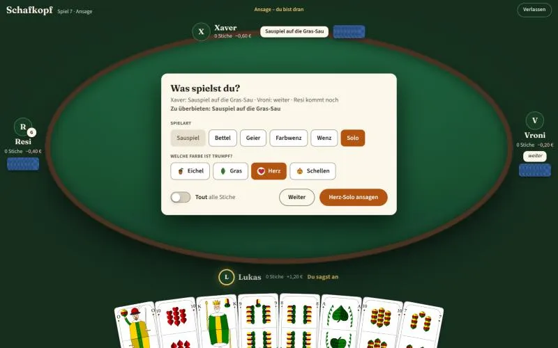   | 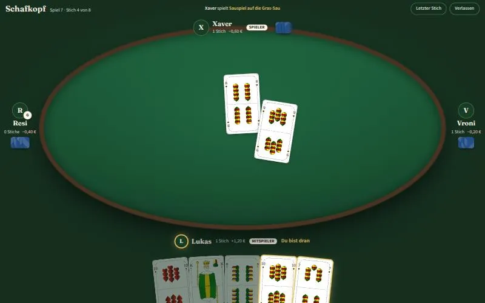   | 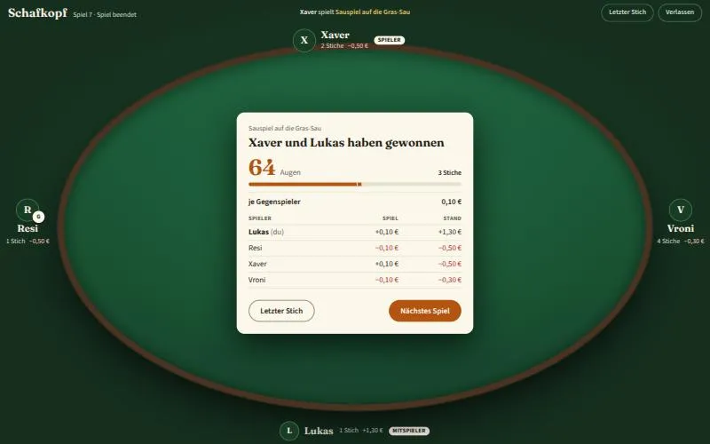   |
| 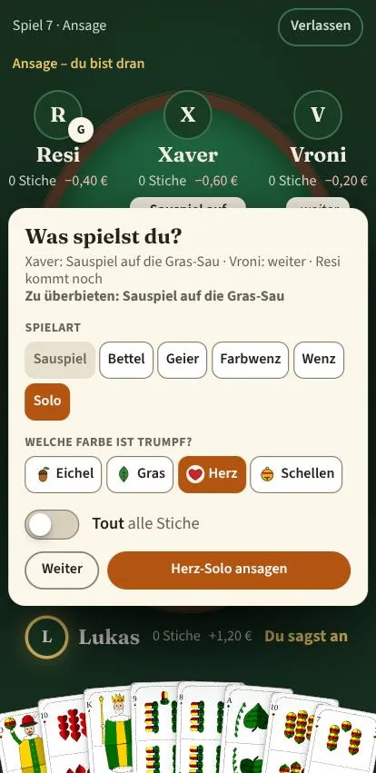 | 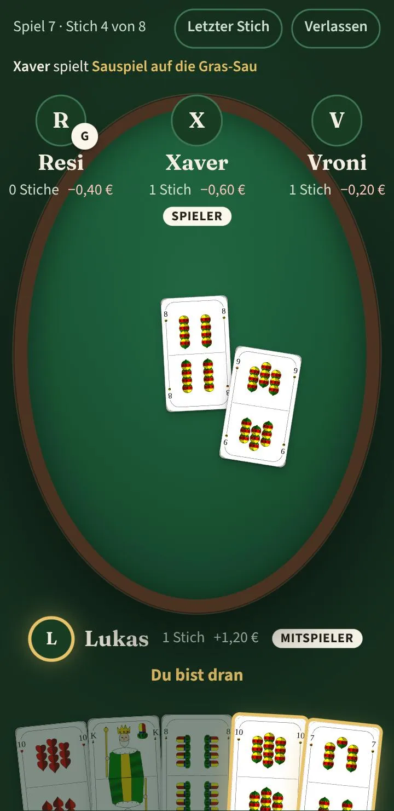 | 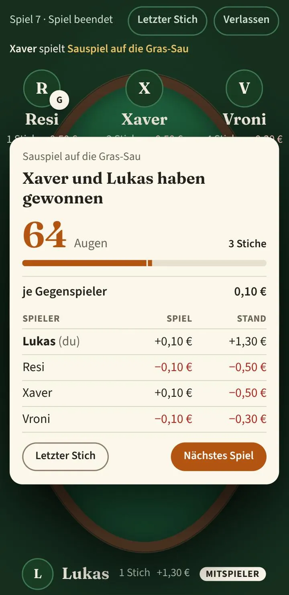 |
| 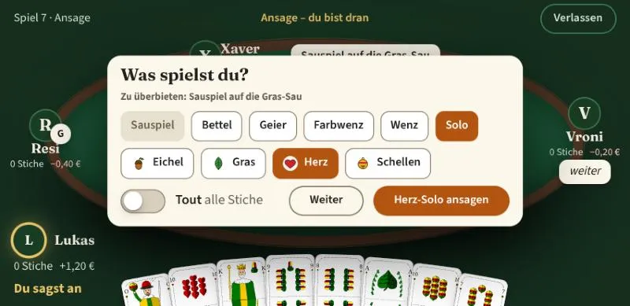         | 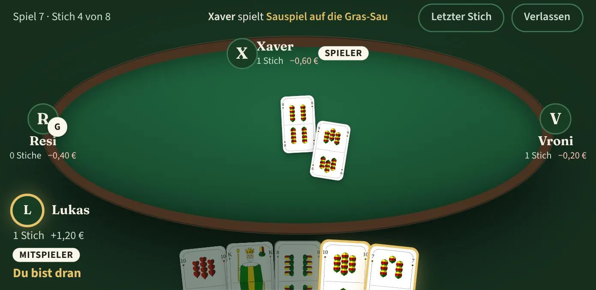         | 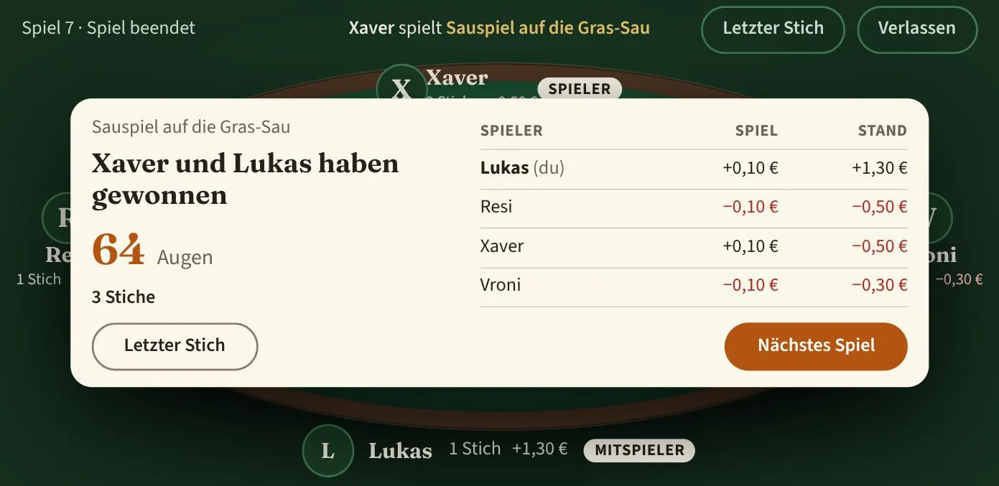         |

### Dateien

| Datei                                      | Inhalt                                                                                                                                                      |
| ------------------------------------------ | ----------------------------------------------------------------------------------------------------------------------------------------------------------- |
| `apps/web/src/ui/Table.tsx`                | verbindet den Tisch mit `ClientSession`/`HostSession`                                                                                                       |
| `apps/web/src/ui/table/TableBoard.tsx`     | der Tisch; arbeitet nur auf `TableView`, Aktionen über Rückrufe                                                                                             |
| `apps/web/src/ui/table/*`                  | `TableBar`, `Seats`, `TrickArea`, `OwnSeat`, `BidDialog`, `ResultDialog`, `LastTrickDialog`; seit dem Spielabend `GameSign`, `LastTrickPile`, `GameHistory` |
| `apps/web/src/ui/table/useTrickDisplay.ts` | hält den fertigen Stich fest und steuert das Wegräumen                                                                                                      |
| `apps/web/src/styles/table.css`            | Layout, Größenstufen und Bewegung des Tischs                                                                                                                |
| `apps/web/src/muster/Tischprobe.tsx`       | Tischprobe mit festen Spielständen, nur im Entwicklungsserver (siehe unten)                                                                                 |

**Tischprobe:** `http://localhost:5180/#tisch?szene=…` mit `ansage` („Ich würde“/„weiter“),
`zweikampf` (du forderst), `halten` (du wirst gefordert), `nennen` (Spiel nennen), `warten`,
`wenz` (du spielst einen Wenz), `tout` (Resi spielt ein Solo Tout),
`stich` (laufender Stich, du bist dran), `letzter` (achter Stich, du legst die letzte Karte),
`ergebnis`, `zuschauer`; mit `&auto=1` spielen die anderen
weiter. Die Spielstände kommen aus dem Kern (fester Seed), ohne Netz.

### Aufbau

- **Leiste:** Spielnummer und Stich („Stich 4 von 8“), was gespielt wird („Xaver spielt Sauspiel
  auf die Gras-Sau“, Spielart in Messing) bzw. wer ansagt, Knöpfe „Regeln“ und „Verlassen“.
- **Die Leiste ist in jedem Zustand gleich hoch** (Ansage, Hochzeit-Vorspiel, Kontra/Re, Hawaii,
  Ramsch, Spiel beendet, lange Bot-Namen, Dreiertisch). _Lukas soll noch bestätigen._
  - Status und Spielstand sind genau **eine Zeile** (`white-space: nowrap`, Auslassung „…“,
    Mindesthöhe `--leiste-zeile`); nichts bricht um. Der volle Text bleibt im DOM für Bildschirmleser.
  - **Handy hochkant (≤ 40rem):** Zeile 1 „Spiel 7“ und die Knöpfe; Zeile 2 der Status links, „Stich 4
    von 8“ (ggf. mit Topf) rechts. **Bis 50rem** steht „X spielt“ nicht mehr in der Zeile, sondern nur
    die Spielart und die Marken – wer spielt, zeigt das Spielschild am Platz; für Bildschirmleser
    bleibt „X spielt …“ erhalten (`.tisch-leiste__wer-teil`, wie `.visually-hidden`).
  - Der eigene Platz hat im hochkant schmalen Fenster eine **feste Markenzeile** (`.eigen__marken`,
    auch leer), damit Spielschild/Mitspieler/Kontra die Infos nicht in eine zweite Zeile schieben.
    Kostet im schmalen Hochformat dauerhaft etwa eine Zeile Tischhöhe. _Lukas soll noch bestätigen._
  - Bilder: `docs/bilder/kopfzeile-*.png` (ansage, stich, wenz, tout, ergebnis, hawaii-kontra; je
    hochkant, quer, desktop). Der ungünstigste Fall (Hawaii + Kontra + Re + langer Name) ist per
    Skript eingesetzt und ändert die Höhe nicht.
- **Lange Namen** (Bots heißen z. B. „Lengschwendtner Sepp (Bot)“): `.player-seat__name` zeigt
  höchstens zwei Zeilen, der Rest wird mit „…“ gekürzt, der volle Name steht im Tooltip. Die Marke
  „am Zug“ sitzt immer mittig unter Name/Bild (oberer Platz im breiten Tisch: dritte Zeile unter
  Name und Nebeninfo). Bilder: `docs/bilder/u8-amzug-*.png`.
- **Regeln-Tafel (`.regeln`)** in Tafeln (Lobby des Gastes): einspaltig, Bezeichnung klein über
  dem Wert; Werte brechen innerhalb der Tafel um (`minmax(0, …)`, `overflow-wrap: anywhere`).
  Bilder: `docs/bilder/u8-regeltafel-*.png`.
- **Plätze der anderen** (`PlayerSeat`): am Zug = Messingschein + Marke „am Zug“, Geber = „G“ am
  Bild, Spielschild bzw. Marke „Mitspieler“ (siehe unten), sobald bekannt; Stiche und Kontostand (Minus in
  Minusfarbe); in der Ansage das Gesagte als Sprechblase („weiter“ kursiv).
- **Punkte vom Spielabend** (umgesetzt am 11.11.2026, Bilder aus der Tischprobe):

  | Schild und Stapel, Desktop                                                        | hochkant                                                                               | quer                                                                                  |
  | --------------------------------------------------------------------------------- | -------------------------------------------------------------------------------------- | ------------------------------------------------------------------------------------- |
  | 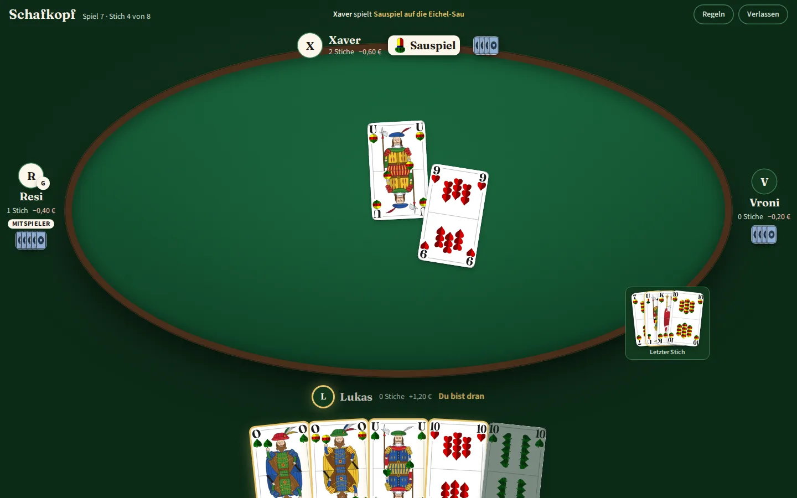 | 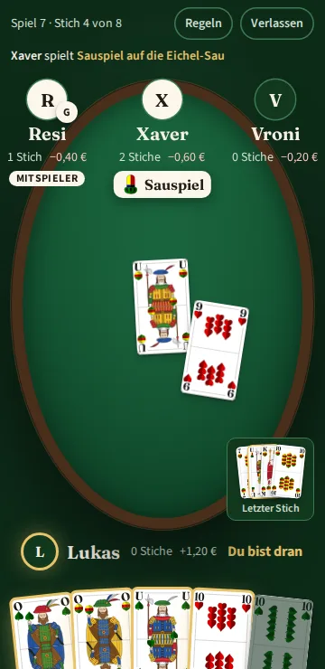    | 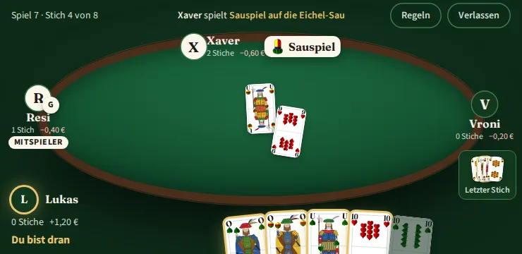           |
  | 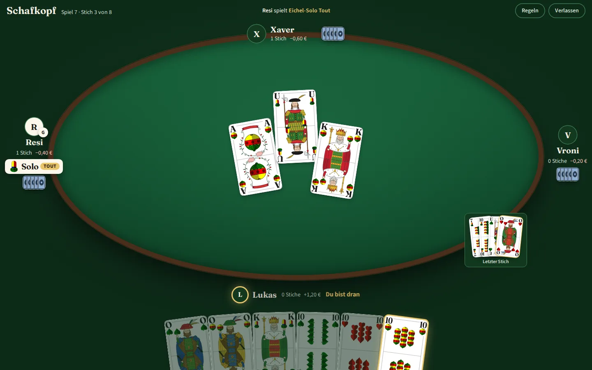           | 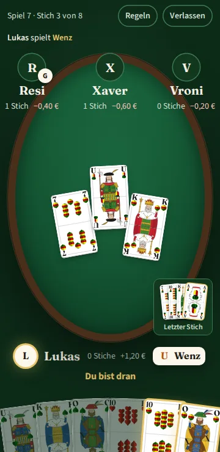 | 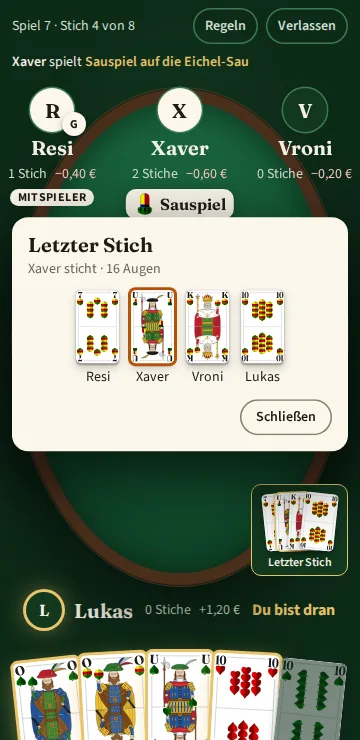 |
  | 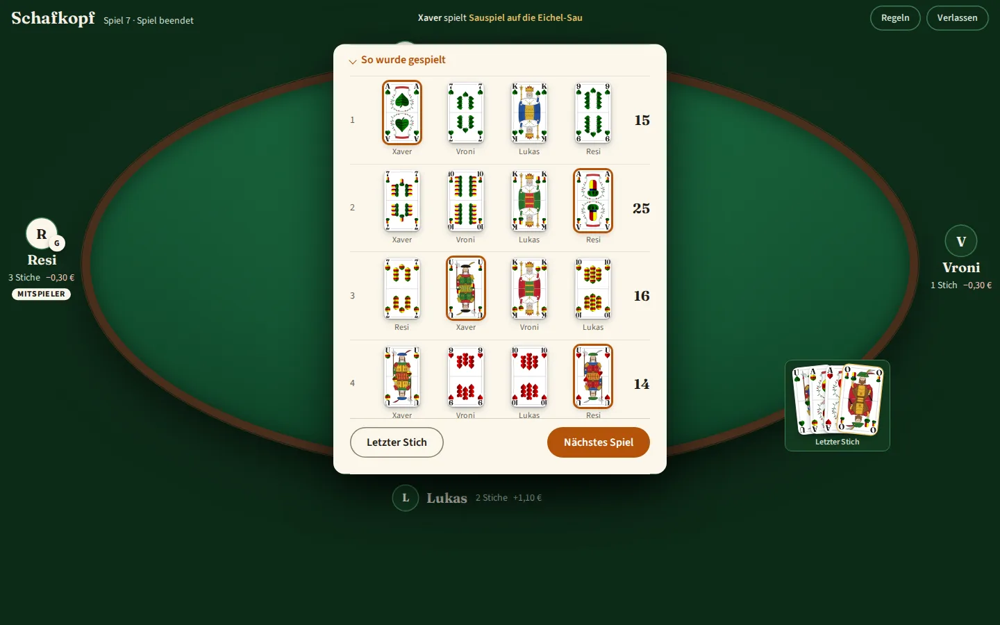                 | 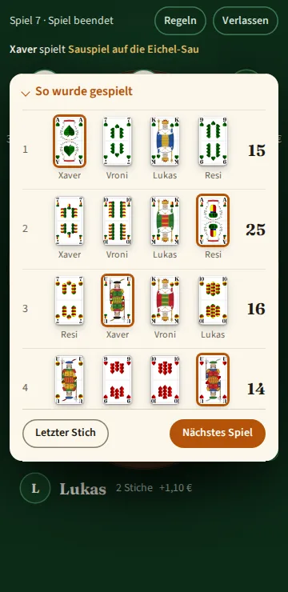                    | 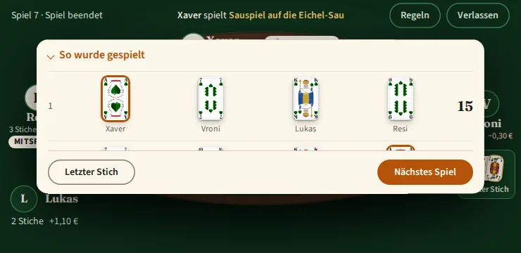                           |

- **Wer spielt was** (Punkt vom Spielabend, umgesetzt nach D3; Lukas soll noch bestätigen):
  - Am Platz des Spielers steht statt der Marke „Spieler“ das **Spielschild** (`GameSign.tsx`):
    Papier mit Schatten, Fraunces, darin das Zeichen und der kurze Name der Spielart – im
    Sauspiel das Farbzeichen der Rufsau, im Solo und Farbwenz das der Trumpffarbe, bei Wenz „U“
    und Geier „O“ (Eckbuchstabe in Akzentfarbe), beim Bettel nur das Wort. Tout als
    Messing-Marke im Schild. Auf breitem Tisch `--text-lg`, sonst `--text-md`; erscheint mit
    `dialog-rein`. Für Bildschirmleser „spielt Sauspiel auf die Gras-Sau“.
  - **Partei hervorgehoben:** Spieler und – sobald bekannt – Mitspieler haben ein helles Bild
    (Papier statt Filz, `player-seat--party` bzw. `eigen--partei`); der Mitspieler behält die
    Marke „Mitspieler“. Der Messingschein „am Zug“ liegt darüber.
  - Die Zeile in der Leiste („Xaver spielt Sauspiel auf die Eichel-Sau“) bleibt als Langform.
  - **Erweiterbar:** `gameSign(hand)` liefert Platz, Zeichen, Namen und Zusätze. Ramsch (kein
    Spieler) bekommt dort `seat: null` und ein Schild in der Tischmitte, Kontra/Re weitere
    Zusätze (`extras`), die Hochzeit einen eigenen Namen.
- **Stich:** mittig, jede Karte vor ihrem Spieler, leicht gedreht. Der fertige Stich bleibt liegen,
  die stechende Karte hat den hellen Rand, darüber „Lukas sticht · 14 Augen“.
- **Eigener Platz:** Bild, Name, Stiche, Stand, Marken, „Du bist dran“/„Du sagst an“ in Messing.
  Darunter die Hand als Fächer, Trümpfe zuerst; die Karten ragen unten aus dem Bild (sichtbar
  `--hand-visible`). Spielbar = Messingrand und hebt sich; nicht spielbar = abgedunkelt.
- **Ansage-Dialog** (zweistufig, K1, von Lukas freigegeben), je Stufe ein eigener Inhalt:
  - „Würdest du spielen?“ – Knöpfe „Weiter“ und „Ich würde“.
  - Zweikampf, man fordert: „Gegen Xaver: Was hast du?“ – nur die Spielart (keine Farbe), Tout als
    Schalter; Knöpfe „Aufgeben“ und „„Wenz“ sagen“. Darunter, wer hält und was zu überbieten ist.
  - Zweikampf, man hält: „Resi sagt: Solo“ – Knöpfe „Gut“ und „Ich auch“.
  - Spiel nennen: erst Spielart, dann Farbe (mit Farbzeichen aus dem Kartenbild, `CardTheme.suit`),
    Tout als Schalter; oben „Mindestens: Wenz“. Geht eine Spielart nur noch als Tout, schaltet die
    Wahl Tout ein und sperrt den Schalter. Ist nur eine Farbe möglich, ist sie vorgewählt.

  Nur was `legalCalls` erlaubt ist wählbar, der Rest gesperrt. Oben: was die anderen zuletzt gesagt
  haben, in der ersten Runde auch, wer noch kommt. Nicht modal; der Fokus springt bei jedem neuen
  Schritt in den Dialog. Die Sprechblasen an den Plätzen zeigen den letzten Ruf („weiter“ und
  „gut“ kursiv).

- **Ergebnis-Dialog:** Spielart, „Xaver und Lukas haben gewonnen“, Augen groß mit Balken (Marke
  bei 61), Stiche/Schneider/Schwarz/Sie/Laufende als Stichworte, Betrag je Gegenspieler, Tabelle
  Spiel/Stand. Die Aufschlüsselung folgt mit U4. Erscheint erst, wenn der letzte Stich weggeräumt
  ist.
- **Kontra und Re (K4):** Solange man darf, steht am eigenen Platz neben „Du bist dran“ der
  Knopf „Kontra“ bzw. „Re“ (Hauptknopf, klein) mit dem Hinweis „bis zur ersten Karte“. Gesagtes
  zeigt eine Marke „Kontra“/„Re“ (Akzentfarbe) am Platz dessen, der es gesagt hat, und in der
  Leiste hinter der Spielart. Im Ergebnis eine Zeile „Lukas sagt Kontra – Spielwert ×2“ und beim
  Betrag „0,50 € × 2 = 1,00 €“.
- **So wurde gespielt** (Punkt vom Spielabend; Lukas soll noch bestätigen): unten im
  Ergebnis-Dialog aufklappbar (`
`, Winkel in Akzentfarbe, per Tastatur bedienbar;
  `GameHistory.tsx`). Je Stich eine Zeile: Nummer, die vier Karten in Spielreihenfolge mit dem
  Namen darunter (`--history-card-w`), die stechende mit Akzentrand wie im Dialog „Letzter
  Stich“, rechts die Augen in Fraunces. Beim Aufklappen rückt der Verlauf nach oben (ohne Gleiten
  bei „Bewegung reduzieren“); der Dialog scrollt, die Knöpfe bleiben unten stehen (`sticky`).
  Quer steht er über die ganze Breite unter Ergebnis und Tabelle; dort ist nur etwa ein Stich auf
  einmal zu sehen.
- **Abrechnung und Abend** (U4; Lukas soll noch bestätigen):
  - _Aufschlüsselung_ (`Breakdown.tsx`) im Ergebnis-Dialog und im Ramsch: eine Liste auf Papier
    unter den Augen – je Bestandteil eine Zeile (Grundtarif, Schneider, Schwarz, Laufende, Tout,
    Sie; Beträge tabellarisch rechts), dann „Spielwert“ als Summe (fett, Linie darüber), die
    Faktoren (Kontra, Re, Jungfrau, Bock) in Akzentfarbe als „× 2“, zuletzt „je Gegenspieler“
    bzw. „je Mitspieler“ fett. Der Pott steht darunter wie bisher (`PotNote`). Quer nur
    kompakt (`--text-xs`) links neben der Tabelle.
  - _Tabelle_: Knopf „Tabelle“ in der Leiste neben „Regeln“ und „Verlassen“ öffnet den Dialog
    „Der Abend“ (`EveningDialog.tsx`, Klasse `abend`, bis 1,5-fache Dialogbreite). Je Spiel eine
    Zeile: Nr., wer was gespielt hat mit „gewonnen“/„verloren“ als Wort (Akzentfarbe nur für
    gewonnen), je Spieler der Betrag und klein darunter der Stand danach; Fußzeile mit dem
    Stand. Wer man selbst ist, steht fett. Hochkant ist die Schrift klein und die Spalte „Spiel“
    schmal, damit alle vier Spieler passen; reicht es nicht, rollt die Tabelle waagerecht (der
    Dialog nicht). Der Ergebnis-Dialog weicht der Tabelle, solange sie offen ist.
  - _Endabrechnung_: unter der Tabelle „Wer zahlt wem“ als Liste („Sepp zahlt Hanni – 3,20 €“),
    eigene Zeilen fett; steht ein Pott, erklärt eine Zeile die Rückzahlung. „Verlassen“ öffnet
    den Dialog zuerst als „Abrechnung vor dem Gehen“ mit „Zurück zum Tisch“ und „Tisch
    verlassen“ (Hauptknopf); ohne gespielte Spiele geht es sofort. Escape schließt.
  - Bilder: `bilder/u4-ergebnis-*.png`, `u4-abend-*.png`, `u4-verlassen-*.png` (hochkant,
    quer, Desktop).
- **Letzter Stich** (Punkt vom Spielabend: der Knopf oben rechts wurde übersehen; Lukas soll noch
  bestätigen): liegt als kleiner **Stapel unten rechts auf dem Filz** (`LastTrickPile.tsx`), sobald
  der erste Stich fertig ist – die vier Karten leicht gefächert (`--trick-card-w` × 0,55), die
  stechende mit Messingrand, darunter „Letzter Stich“, auf dunkler Fläche (`--color-felt-raised`).
  Das ganze Feld ist ein Knopf (mind. `--control-height`); Hover und offen = Messingrand. Antippen
  oder Enter öffnet den Dialog mit den vier Karten und Namen; Escape schließt, der Fokus kehrt auf
  den Stapel zurück. Während ein fertiger Stich noch in der Mitte liegt, zeigt der Stapel schon
  diesen (sonst ginge beim Verschwinden der Fokus verloren). Hochkant in der Ecke unten rechts,
  quer rechts unten am Filzrand. Der Knopf in der Leiste ist weg; im Ergebnis-Dialog bleibt er.

### Dreier-Tisch (K6)

Zu dritt sitzen die zwei anderen **links und rechts**, oben bleibt der Filz frei
(`positionOf` in `ui/table/layout.ts`). Es gibt keine eigenen Stile: Die Plätze und die Karten
im Stich nutzen die vorhandenen Stellungen `left`/`right`/`bottom`, deshalb passt die Anordnung
in allen Größenstufen. Hochkant stehen die beiden oben in den Ecken wie zu viert der linke und
rechte Platz. In der Lobby wählt der Gastgeber unter „Spieler und Karten“ die Besetzung;
Spielarten, die zur Besetzung nicht passen, sind ausgegraut und mit „nicht zu dritt“ bzw.
„nicht mit kurzer Karte zu viert“ beschriftet, „Muss“ zu dritt ebenso.

| Ansage, hochkant                                                       | Stich, hochkant                                                      | Stich, quer                                                  |
| ---------------------------------------------------------------------- | -------------------------------------------------------------------- | ------------------------------------------------------------ |
| 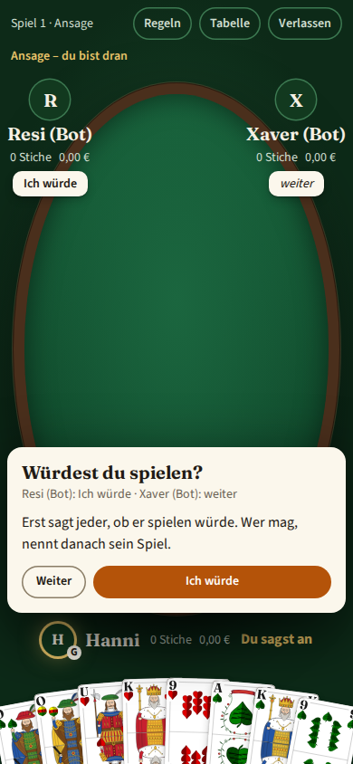 | 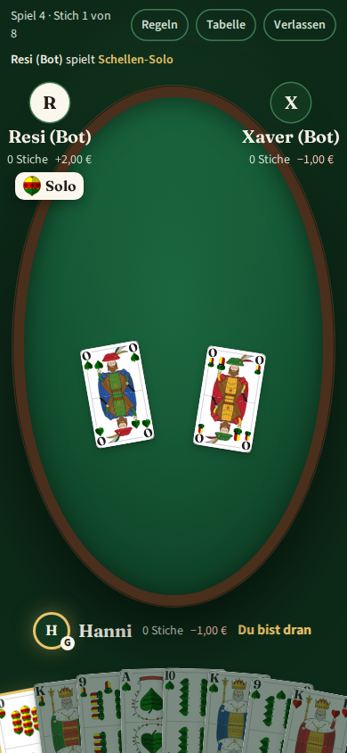 | 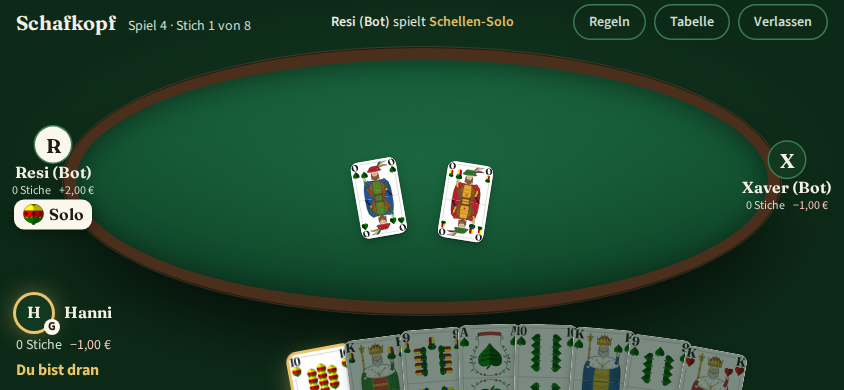 |

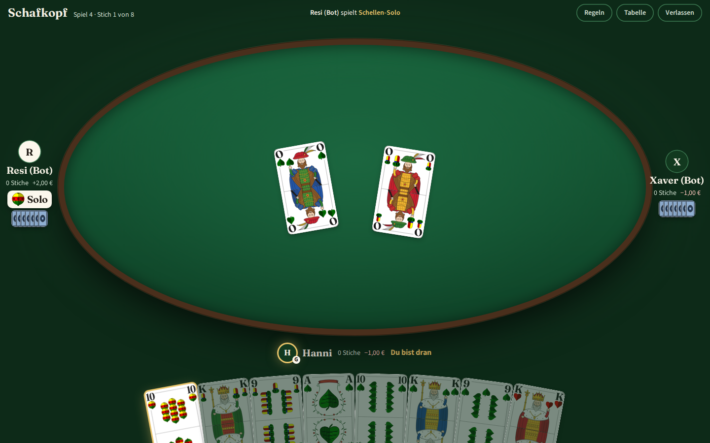

Die Bilder entstehen mit `BILDER=1 npx playwright test e2e/dreier.spec.ts`.

### Größenstufen

Der Raum zwischen Leiste und Hand ist ein Größen-Container (`container: tisch`); Stichkarten
(`--trick-card-w`, `17cqmin`) und Plätze richten sich nach ihm. Die Grenzwerte stehen als feste
Werte in den Abfragen, weil dort keine Variablen gehen.

| Stufe           | Abfrage                        | Änderung                                                                    |
| --------------- | ------------------------------ | --------------------------------------------------------------------------- |
| breiter Tisch   | Container ≥ 40rem breit        | oberer Platz liegt quer (Bild, Name, Marken, Karten in einer Reihe)         |
| hochkant        | Container Seitenverhältnis < 1 | alle drei Plätze oben, Stich tiefer, Ansage unten über der Hand             |
| schmal          | Container ≤ 30rem breit        | Dialoge knapper (kleinere Wahlknöpfe, Farben in einer Zeile)                |
| niedrig (quer)  | Container ≤ 18rem hoch         | Plätze ohne verdeckte Karten, Ansage ohne Statuszeile, Ergebnis zweispaltig |
| Leiste schmal   | Fenster ≤ 40rem / ≤ 50rem      | Status in eigener Zeile / ohne Schriftzug                                   |
| Fenster niedrig | Fenster ≤ 30rem hoch           | eigene Infos links neben der Hand, Karten ragen weiter hinaus               |

Der Tisch hat `overflow: clip` (nicht `hidden`), damit der Fokus auf einer hinausragenden Karte
ihn nicht verschiebt. Kein horizontales Scrollen: Die Überlappung der Hand richtet sich nach
der Breite (`--hand-avail`).

**Die Tischfläche bleibt im ganzen Spiel gleich groß** (Fehler vom Spielabend: „Tisch springt bei
letzter Karte“). Deshalb bleibt die Handzeile auch ohne Karten mit ihrer Höhe stehen, „Du bist
dran“ hält unsichtbar seinen Platz, und die Leiste hat immer dieselben Knöpfe (früher erschien
„Letzter Stich“ erst ab dem zweiten Stich und die Leiste brach am Handy anders um). Im niedrigen Fenster steht die Hand rechts neben den eigenen Infos
(`--own-info-width`), damit diese keine Karte verdecken. Abgesichert in `e2e/layout.spec.ts`
(360×740, 740×360, 1440×900) über mindestens drei Spiele, auch zusammengeworfene, und misst
zusätzlich die Höhe der Leiste; in der Tischprobe zeigt die Szene `letzter` den achten Stich.

### Bewegung

| Bewegung              | Dauer                                                 | Wie                                                          |
| --------------------- | ----------------------------------------------------- | ------------------------------------------------------------ |
| Karte legen           | `--duration-slow` 360 ms                              | gleitet vom Platz des Spielers in den Stich                  |
| Stich liegt           | 1 s (`TRICK_HOLD_MS`)                                 | ruhig; stechende Karte hebt sich (`scale`)                   |
| Stich wegräumen       | `--duration-sweep` 420 ms                             | wandert zum Gewinner, wird kleiner und blasser (`--ease-in`) |
| Austeilen             | 360 ms, Versatz `--duration-deal-step` 45 ms je Karte | Karten kommen nacheinander vom Tisch herunter                |
| Fächer zusammenrücken | `--duration-base` 200 ms                              | nach dem Ausspielen                                          |
| Dialoge, Sprechblasen | `--duration-slow` / `-base`                           | blenden ein und wachsen leicht (nur Deckkraft und `scale`)   |

Bei „Bewegung reduzieren“ sind alle Dauern 0: Alles steht sofort an seinem Platz; der fertige
Stich bleibt trotzdem 1 s liegen, damit man die vierte Karte sieht. `useTrickDisplay` liest
`--duration-sweep` aus dem CSS, damit Zeitgeber und Animation zusammenpassen.

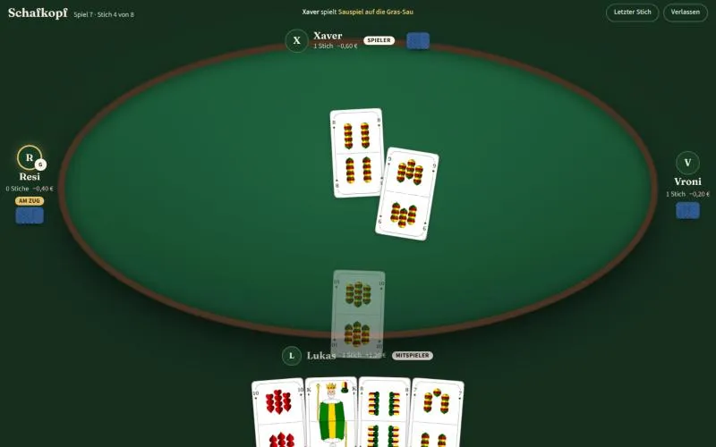
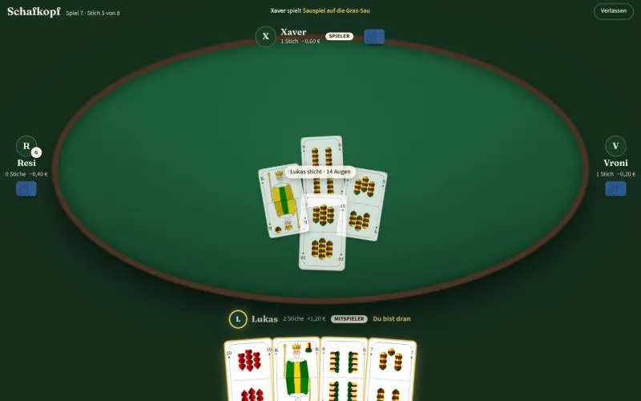

### Offen (für spätere Pakete)

- **Sichten:** Für den Tisch hat in `TableView`/`HandView` nichts gefehlt.
- **Hand umsortieren:** Wird nach der Ansage nach der Spielart neu sortiert, springen die Karten
  an ihren Platz (keine Bewegung).
- **Quer:** Die Ansage verdeckt den oberen Platz teilweise; das Gesagte steht im Dialog selbst.
- **Verdeckte Karten der anderen** werden nicht einzeln ausgeteilt, sondern blenden ein.

## Start und Lobby (D4, freigegeben am 11.11.2026)

Alle Ansichten außerhalb des Spieltischs im Stil „Kartentisch“, mit den Variablen und Bausteinen
aus D2. **Von Lukas freigegeben am 11.11.2026.** Vorab gewählt: Start schlicht auf Filz, Plätze in
der Lobby als kleiner Tisch, Einladung ganz oben mit großem Tisch-Code, Fehler als Zettel unten.

| Start                                                    | Lobby, Gastgeber                                                             | Lobby, Gast                                                        | Fehlschlag                                                             |
| -------------------------------------------------------- | ---------------------------------------------------------------------------- | ------------------------------------------------------------------ | ---------------------------------------------------------------------- |
| 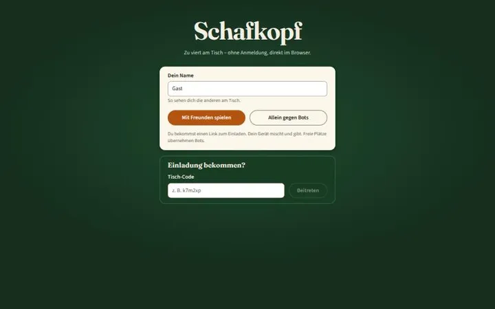 | 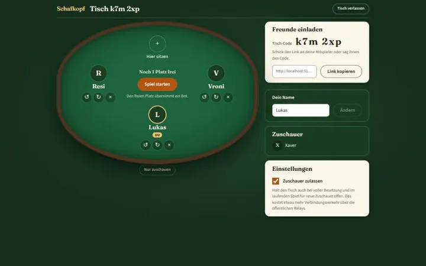 | 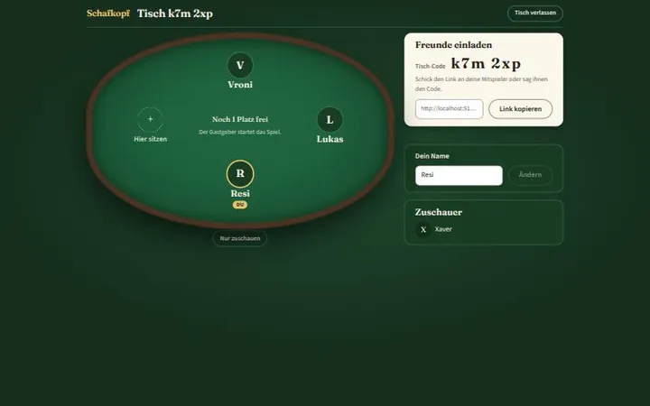 | 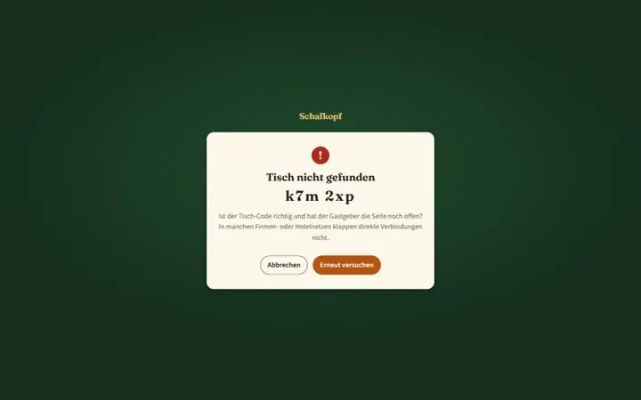 |

| Start                                                | Fortsetzen                                                     | Lobby, Gastgeber                                                         | Lobby, Gast                                                    | Suche                                                | Hinweis                                                  |
| ---------------------------------------------------- | -------------------------------------------------------------- | ------------------------------------------------------------------------ | -------------------------------------------------------------- | ---------------------------------------------------- | -------------------------------------------------------- |
| 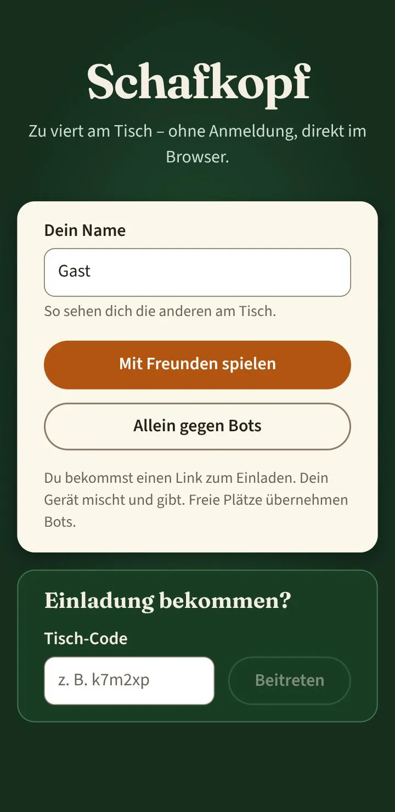 | 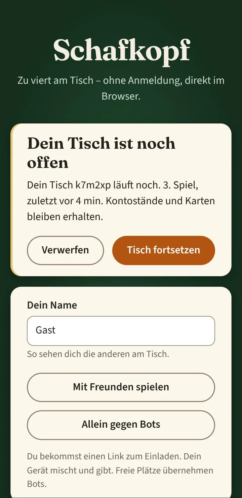 | 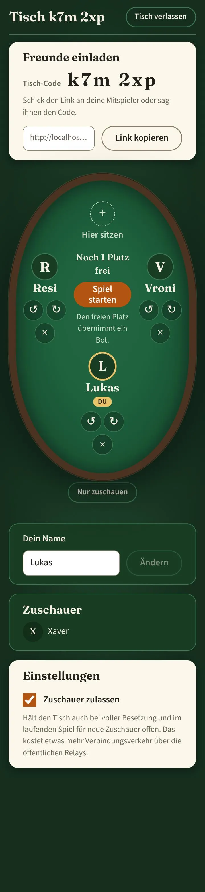 | 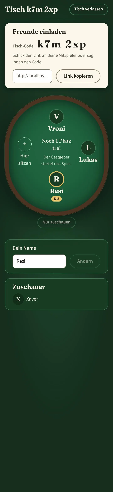 | 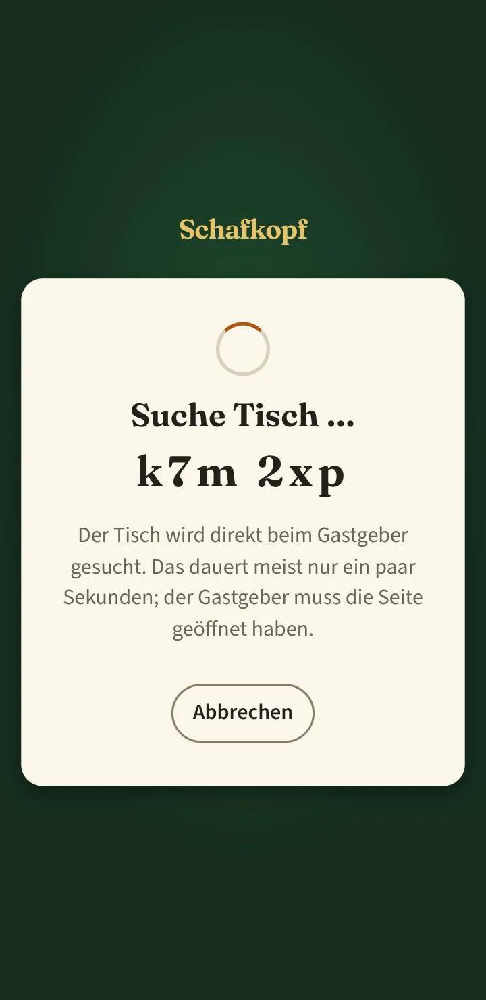 | 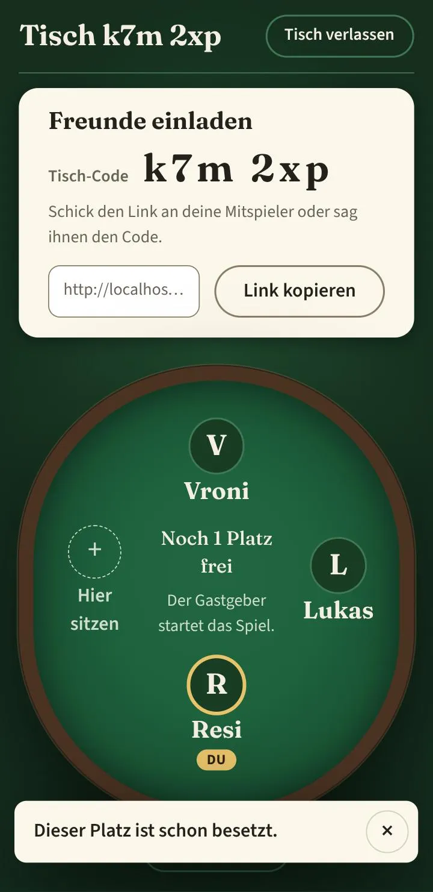 |

### Dateien

| Datei                                   | Inhalt                                                                     |
| --------------------------------------- | -------------------------------------------------------------------------- |
| `apps/web/src/ui/StartScreen.tsx`       | Start, Beitreten über den Einladungslink, Fortsetzen-Angebot (N2)          |
| `apps/web/src/ui/Lobby.tsx`             | Lobby: Einladung, Tisch mit Plätzen, Name, Zuschauer, Einstellungen        |
| `apps/web/src/ui/ConnectStatus.tsx`     | Tisch suchen / nicht gefunden; Zettel „Verbindung verloren“                |
| `apps/web/src/ui/Notice.tsx`            | Hinweis-Zettel unten für `ERROR_TEXT`                                      |
| `apps/web/src/ui/JoinRequests.tsx`      | Beitrittsanfragen beim Gastgeber (N6), Zettel oben über Lobby und Tisch    |
| `apps/web/src/styles/screens.css`       | Stile dieser Ansichten; die alten Übergangsstile aus `styles.css` sind weg |
| `apps/web/src/muster/Ansichtsprobe.tsx` | Ansichtsprobe mit festen Zuständen, nur im Entwicklungsserver (unten)      |

**Ansichtsprobe:** `http://localhost:5180/#ansicht?szene=…` mit `start`, `einladung`, `fortsetzen`,
`lobby-gastgeber`, `lobby-gast`, `lobby-zuschauer`, `lobby-lokal`, `suche`, `fehlgeschlagen`,
`verloren`, `hinweis`. Die Lobby läuft dort über einen echten `HostSession` mit
Loopback-Verbindungen, ohne Relays.

### Aufbau

- **Start:** Schriftzug „Schafkopf“ (Fraunces, `--text-brand`) und eine Zeile darunter. Eine
  Papiertafel mit „Dein Name“, „Mit Freunden spielen“ (Hauptknopf) und „Allein gegen Bots“;
  darunter eine dunkle Tafel „Einladung bekommen?“ mit Tisch-Code und „Beitreten“. Ohne Namen
  bleiben die Knöpfe bedienbar und das Feld zeigt den Fehler „Bitte gib zuerst deinen Namen ein.“
  (statt stumm gesperrter Knöpfe).
- **Einladungslink** (`#tisch=code`): gleich „Du bist eingeladen an Tisch k7m 2xp“ mit Name und
  „Beitreten“; „Lieber selbst einen Tisch eröffnen“ führt zum normalen Start.
- **Fortsetzen (N2):** Tafel „Dein Tisch ist noch offen“ mit Messingkante ganz oben, Knöpfe
  „Verwerfen“ und „Tisch fortsetzen“. Solange sie steht, ist „Tisch fortsetzen“ die einzige
  Hauptaktion; „Mit Freunden spielen“ wird sekundär.
- **Tisch-Code** überall in Dreiergruppen und gesperrt (`spacedCode`, `--tracking-code`), damit
  man ihn vorlesen kann.
- **Lobby:**
  - Leiste: Schriftzug (Messing, am Handy weg), „Tisch k7m 2xp“, „Tisch verlassen“.
  - Einladung zuerst: großer Code, Link zum Markieren, „Link kopieren“ (→ „Kopiert“; geht die
    Zwischenablage nicht, ein Hinweis in Minusfarbe). Am Tisch gegen die Bots entfällt sie.
  - Der Tisch: ovaler Filz im Holzrahmen (`--shadow-rim`), die vier (zu dritt drei) Plätze ringsum
    in derselben Anordnung wie im Spiel (du unten mit Messingring und Marke „du“; Zuschauer sehen ihn aus
    Sicht von Platz 1). Freier Platz = gestrichelter Stuhl mit „Hier sitzen“, die ganze Fläche ist
    der Knopf. In der Mitte „Noch 1 Platz frei“ und für den Gastgeber „Spiel starten“ (mit
    „Den freien Platz übernimmt ein Bot.“), für Gäste „Der Gastgeber startet das Spiel.“
  - Gastgeber-Steuerung an jedem besetzten Platz: ↺ / ↻ rücken einen Platz gegen bzw. im
    Uhrzeigersinn weiter (tauscht mit dem Nachbarn, auch mit einem freien Platz), × nimmt vom
    Platz. Beschriftet für Bildschirmleser mit Name und Richtung.
  - Unter dem Tisch „Nur zuschauen“ bzw. der Hinweis für Zuschauer.
  - Seitenspalte (Desktop rechts, Handy darunter): „Dein Name“ zum Ändern, Zuschauer, und nur
    für den Gastgeber die Tafel „Einstellungen“ (`#tisch-einstellungen`) – der Rahmen für die
    Tischregeln aus K2, darin „Zuschauer zulassen“.
- **Verbinden:** Papiertafel mittig, „Suche Tisch …“ mit Messing- bzw. Akzent-Ring und dem Code,
  Erklärung, „Abbrechen“. Nach der Zeitüberschreitung rotes „!“, „Tisch nicht gefunden“,
  „Abbrechen“ und „Erneut versuchen“.
- **Verbindung verloren:** Messing-Zettel oben über Lobby und Tisch („Verbindung zum Gastgeber
  verloren – suche Tisch …“ mit kleinem Ring; danach „Gastgeber nicht mehr erreichbar.“ und
  „Erneut versuchen“). Nicht modal.
- **Neue Mitspieler bestätigen (N6):** In „Einstellungen“ unter „Zuschauer zulassen“ ein zweites
  Kästchen mit Erklärung (ohne Einladungslink gesperrt). Beim Gast statt „Suche Tisch …“ dieselbe
  Papiertafel mit Ring: „Warte auf Zusage von Hanni …“, Code, Erklärung, „Abbrechen“. Abgewiesen:
  rotes „!“, „Nicht zugelassen“, Hauptknopf „Zurück zum Start“. Beim Gastgeber je Anfrage ein
  Papierzettel oben mittig (`JoinRequests.tsx`, `.join-requests`): Messingkante links, „Sepp
  möchte an den Tisch.“, „Abweisen“ (sekundär) und „Zulassen“ (Hauptknopf), beide klein und für
  Bildschirmleser mit Namen beschriftet. Die Zettel liegen fest über Lobby und Tisch (unter der
  Leiste, `--join-requests-offset`), verschieben nichts und verschwinden erst mit der
  Entscheidung (oder wenn der Gast geht). Am Handy decken sie solange die oberen Plätze ab.
- **Hinweise** (`ERROR_TEXT`): kleiner Papierzettel unten mittig, blendet ein, verschwindet nach
  5 s (`NOTICE_MS`) oder mit ×; `role="status"`. Am Tisch steht er über der Hand
  (`--hand-card-h` × `--hand-visible`).
- **Ergebnis-Dialog:** geprüft, passt zum Rest (Papier, Akzentknopf, Minusfarbe); unverändert.

### Größen und Bedienung

| Stufe             | Abfrage           | Änderung                                                        |
| ----------------- | ----------------- | --------------------------------------------------------------- |
| Start breit       | Fenster ≥ 40rem   | „Mit Freunden spielen“ und „Allein gegen Bots“ nebeneinander    |
| Lobby zweispaltig | Fenster ≥ 60rem   | Tisch links, Einladung und Seitenspalte rechts (`--side-width`) |
| Tisch breit       | Container ≥ 34rem | Tisch quer (`--lobby-table-ratio`), größere Bilder              |
| Leiste schmal     | Fenster ≤ 40rem   | Schriftzug in der Leiste entfällt                               |

- Alles mit der Tastatur erreichbar; Formulare senden mit Enter. Der Fokusring folgt der Fläche
  (Messing auf Grün, Akzent auf Papier). Der Name hat beim Start den Fokus.
- Kein horizontales Scrollen bei 360 px.
- „Bewegung reduzieren“: Der Suchring steht still (`--duration-spin` gilt dann nicht), die Zettel
  erscheinen ohne Einblenden (Dauern 0).

### Offen (für spätere Pakete)

- **Handy, Gastgeber:** Mit den Steuerknöpfen ist der Tisch höher als der Bildschirm. Falls das
  stört: Knöpfe in ein kleines Menü am Platz.
- **Teilen-Menü am Handy** (`navigator.share`) ist nicht eingebaut (Lukas hat es nicht gewählt).
- **Gastgeber erkennbar:** `TableView` sagt nicht, wer den Tisch hostet; eine Marke
  „Gastgeber“ am Platz bräuchte das in der Sicht.

## Trainer Max Weber (T2) – _Lukas soll noch bestätigen_

Allein gegen Bots schaut auf Wunsch **Max Weber** zu – eine Figur mit Sprechblase am Tisch,
ruhig und ohne Ton. Gestaltung und Didaktik hat die Umsetzung selbst entschieden (Lukas war
nicht erreichbar); alles Folgende soll Lukas über die Bilder bestätigen.

| Frage stellen                                           | Denkanstoß (Stufe 1)                                             | Empfehlung (Stufe 2)                                            | Begründung (Stufe 3)                                             |
| ------------------------------------------------------- | ---------------------------------------------------------------- | --------------------------------------------------------------- | ---------------------------------------------------------------- |
| 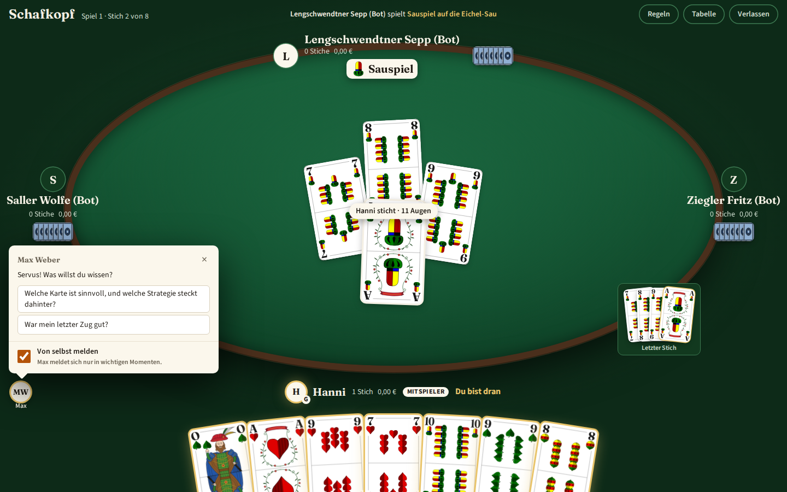   | 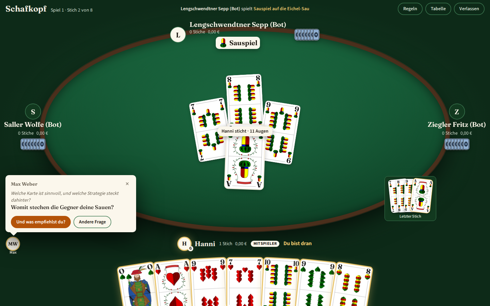   | 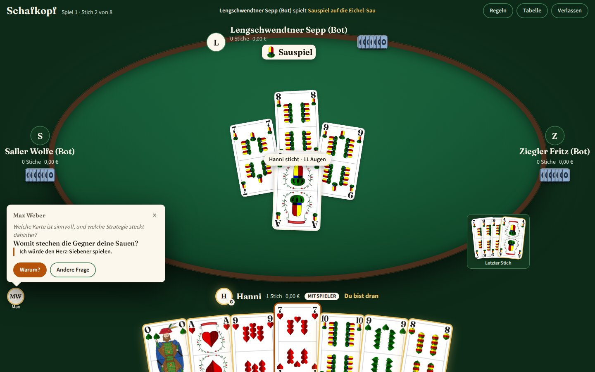   | 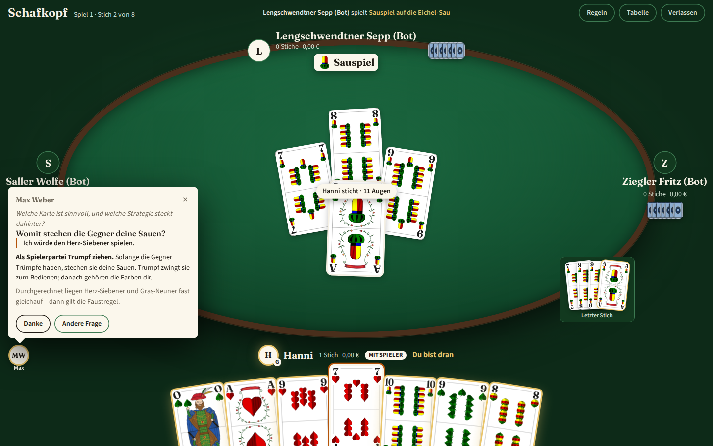   |
| 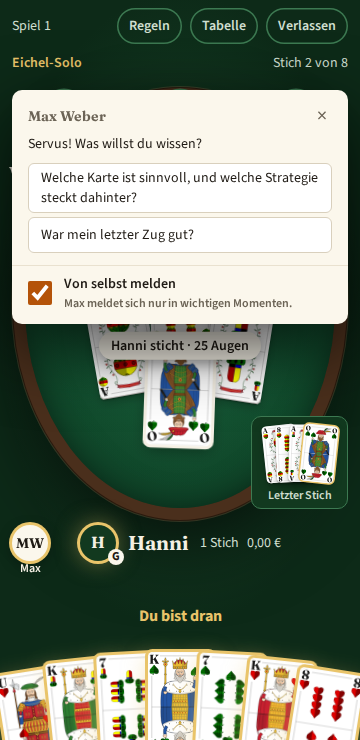 | 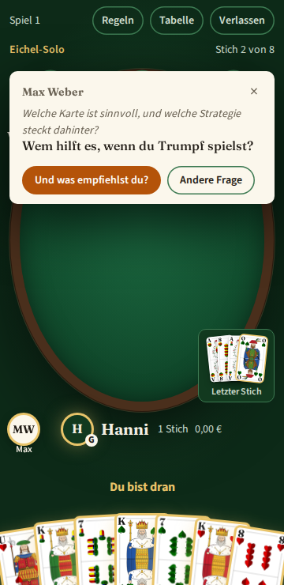 | 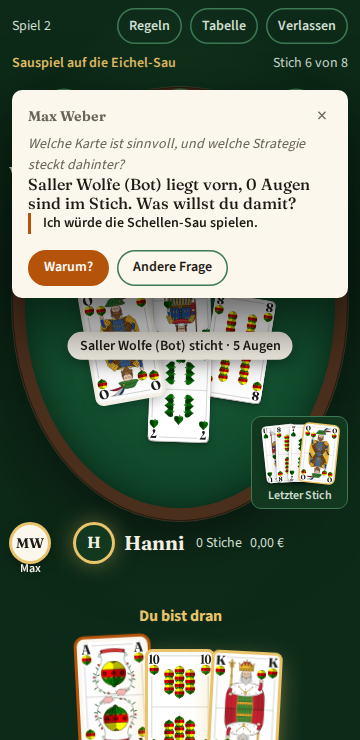 | 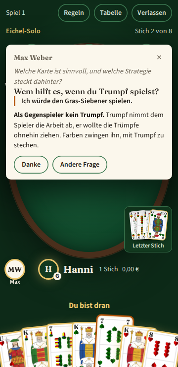 |
| 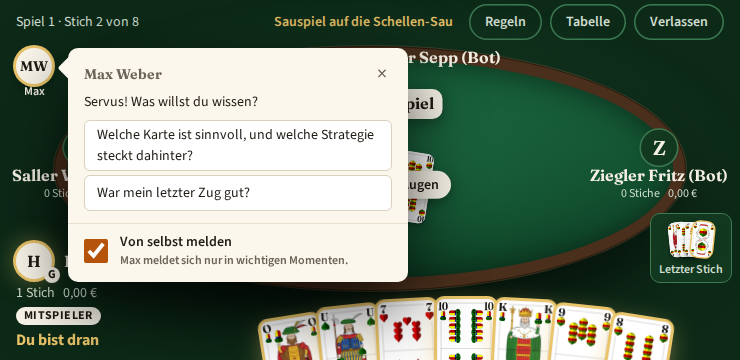         |          |          |          |

| Bewertung hinterher                                         | Rückblick „So wurde gespielt“                                  | Rückblick, Kopf                                                       |
| ----------------------------------------------------------- | -------------------------------------------------------------- | --------------------------------------------------------------------- |
|  |    |  |
|        |  |                 |

Die Bilder entstehen mit `BILDER=1 npx playwright test e2e/trainer.spec.ts` (je nach Spielverlauf
dazu `*-0-automatik.png`, wenn sich Max von selbst gemeldet hat, und `*-5-hinterher.png`).

### Figur

- Ein runder Kopf wie die Plätze, aber auf **Papier mit Messingring** und den Initialen **„MW“**
  in Fraunces, darunter klein „Max“. So unterscheidet er sich von den Mitspielern (Filz, ein
  Buchstabe) und gehört trotzdem zum Tisch. Kein Bild einer Person, kein Maskottchen.
- **Feste Stelle:** auf breitem Tisch und hochkant links neben dem eigenen Namen – er sitzt neben
  dir und schaut dir über die Schulter. Im niedrigen Fenster (Handy quer) oben links auf dem Filz,
  weil unten neben dem Namen kein Platz ist.
- Die Figur ist ein Knopf (Tippfläche mindestens `--control-height`): Antippen öffnet die
  Auswahlfragen, noch einmal Antippen schließt. Hover und offen: dickerer Messingring.

### Sprechblase

- **Papier** wie die Dialoge, Radius `--radius-md`, Schatten `--shadow-dialog`, oben klein
  „Max Weber“ und ein Schließen-Kreuz. Erscheint mit `dialog-rein` (nur Deckkraft und Größe).
- **Liegt über dem Tisch, nimmt keinen Platz:** Der Tisch springt beim Ein- und Ausblenden nicht
  (Layout-Test in allen drei Größen, mit auf- und zugehender Blase).
- **Stelle:** Desktop unten links über der Figur, mit Spitze zu ihr; so breit, dass sie neben dem
  Ansage- und Ergebnis-Dialog bleibt (höchstens 24rem). Hochkant **oben über den Plätzen** in
  voller Breite, weil unten der Ansage-Dialog liegt – dort verdeckt sie für den Moment die Namen
  der anderen (so von Lukas abgenommen, 12.11.2026). Quer rechts neben der Figur oben links; dort
  verdeckt sie einen Teil des Filzes.
- **Lange Antworten** scrollen in der Blase; die Knöpfe bleiben unten stehen.
- **Inhalt:**
  - _Auswahlfragen_ als Liste heller Knöpfe („Welche Karte ist sinnvoll, und welche Strategie steckt
    dahinter?“ usw.), darunter der Schalter „Von selbst melden“.
  - _Antwort_: die gestellte Frage klein und kursiv, darunter der **Denkanstoß in Fraunces** – er
    ist das Wichtigste. Hauptknopf „Und was empfiehlst du?“, dann „Warum?“, daneben immer
    „Andere Frage“. Die Empfehlung steht mit einem Akzentstrich links („Ich würde den
    Schellen-Siebener spielen.“), die Begründung mit dem fett gesetzten Titel der Faustregel,
    darunter leise, was die Rechnung sagt („Durchgerechnet bringt … im Schnitt etwa 12 Cent
    mehr als …“). Cent nennt Max erst hier, nie im Denkanstoß.
  - _Von selbst_ (Automatik): „**Moment –** Partner hält den Stich. Kann ihn noch jemand holen?“ –
    „Moment –“ in Akzentfarbe, sonst wie eine Antwort in Stufe 1.
  - _Hinterher_: „Kurz zu deinem Zug: Der Gras-Unter hat dich etwa 11 Cent gekostet.“ – auf Wunsch
    „Was wäre besser gewesen?“ mit Empfehlung und Faustregel.
- **Ton:** Du-Form, kurze Sätze, „Servus!“ zur Begrüßung; „das kostet“, nicht „falsch“.

### Empfehlung am Tisch (ab Stufe 2)

- **Karte:** hebt sich und bekommt einen doppelten Ring (Papier, dann Akzentfarbe) – deutlich
  anders als der Messingrand spielbarer Karten. Ein Schild „Max“ über der Karte wurde verworfen:
  am Desktop stößt es an den eigenen Namen.
- **Ansage, Kontra, Re:** Der empfohlene Knopf bzw. Wahlknopf bekommt einen gestrichelten
  Rahmen in Akzentfarbe.
- Die Hervorhebung verschwindet, sobald man zieht oder die Lage sich ändert.

### Rückblick in „So wurde gespielt“

- In der Zeile „So wurde gespielt“ rechts eine Marke in Akzentfarbe: „Max hat 2 Stellen markiert“.
- Aufgeklappt oben ein Kasten mit dem Kopf „MW“: was er markiert hat (Ansage und Kontra stehen
  hier direkt), oder „kein teurer Fehler in diesem Spiel“.
- Stiche mit einem Fehler: Zeile leicht hinterlegt mit Akzentstrich links, die eigene Karte mit
  gestricheltem Rahmen, darunter der Satz „**Hinweis von Max:** Der Gras-Achter wäre besser gewesen
  als der Gras-Zehner (etwa 19 Cent). Faustregel: In verlorene Stiche einen Spatz.“
- Höchstens **drei Stellen** – die teuersten; weitere nur als „Dazu ein kleinerer Fehler.“

### Lobby

Nur am Tisch gegen die Bots: Tafel „Trainer“ mit „Max Weber schaut mir über die Schulter“ und
„Meldet sich in wichtigen Momenten von selbst“, beide **standardmäßig an**. Begründung: Wer
„Allein gegen Bots“ wählt, übt meist; Max drängt sich nicht auf (von selbst nur bei hohem
Einsatz, höchstens einmal je Stich) und ist mit einem Klick aus. Die Wahl merkt sich das Gerät.

## Mehrere Kartensets (U9)

Der Gastgeber wählt in der Lobby das Kartenbild für alle am Tisch (`RuleSet.cardSet`, Standard
„bayerisch“). Gäste sehen die Wahl in der Regel-Tafel. Die Sätze stehen in der Registry
`apps/web/src/ui/cardTheme.tsx`; ein Satz liefert 32 Karten, Rücken und vier Farbzeichen,
Fehlendes kommt vom bayerischen Bild. Namen der Farben und Ränge sowie die Eckbuchstaben des
Spielschilds gelten für alle Sätze. Zusatzkarten außerhalb des Schafkopfs (Sechser, Weli) trägt ein
Satz unter `extras`.

### Salzburger Bild (12.11.2026, von Lukas abgenommen)

Gemeint ist das Salzburger bzw. einfachdeutsche Bild der Tiroler Wattkarten (Lukas, 12.11.2026):
einfachbildig, ganze Figuren, Zahlkarten mit kleinen Szenen, Weli als Schellen-Sechs.

**Weg:** eigene Vektorzeichnung im modernen Stil (klare Farben, schwarze Umrisse), erzeugt mit
`apps/web/scripts/karten/salzburger.mjs`. Linien, Farben, Gesichter und Farbzeichen stammen aus dem
U2-Generator. Motive und Aufbau folgen dem überlieferten Bild; als Vorlage dienten gemeinfreie
Drucke um 1800 (Columbia University) und um 1848 (Anton Fuchs). Herkunft:
`apps/web/src/assets/kartensets/salzburger/QUELLEN.md`. 36 Karten (6 bis Sau, Weli statt
Schellen-Sechs), zusammen etwa 260 kB.

**Verworfene Wege:**

- **Rasterbilder:** Die freien Scans auf Commons sind nur etwa 100 × 190 Pixel groß und auf dem
  Handy unscharf. Die großen Scans der Columbia University (gemeinfrei, um 1800) wirken
  automatisch vektorisiert wie grobe Holzschnitte.
- **Fertige Vektordateien:** Ein freier SVG-Satz des Salzburger Bilds existiert nicht.
- **Heutige Druckvorlagen abzeichnen:** Lukas wünschte eine 1:1-Kopie einer Druckerei-Vorlage.
  Wir haben sie nicht übernommen, weil die Rechte an der konkreten Zeichnung offen sind. Die
  Motive sind dieselben, die Ausführung ist eigene Arbeit.

**Bilder:** `docs/bilder/kartensets/salzburger-alle-karten.webp` (alle 36 Karten),
`vergleich-bayerisch-salzburger.webp` (Karte neben Karte), `tisch-{hochkant,quer,desktop}.webp`,
`lobby-{hochkant,quer,desktop}.webp`.

**Entscheidung (Lukas, 12.11.2026):** Der Satz bleibt vorerst, wie er ist: vereinfachter Stil,
Könige vor dem Thron, Zahlkarten ohne Eckzeichen (Zehner mit „X“), bayerischer Rücken. In der
Lobby heißt er „Salzburger“.

## Verworfene Richtungen

- **A · Stube** (`docs/entwuerfe/stube.html`): dunkles Nussholz mit Bernstein – „ok“, aber das
  Grün gefällt besser. 
- **C · Schiefer** (`docs/entwuerfe/schiefer.html`): flaches Graphit mit Herzrot und
  Kreidetafel – nicht gewählt. 
- **Rauten** (erste Runde): Nachtblau mit Rautenmuster – „geht gar nicht“, Entwurf gelöscht.
